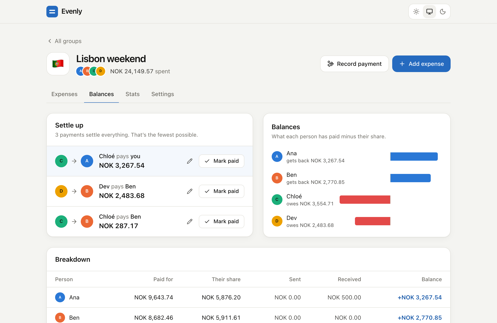
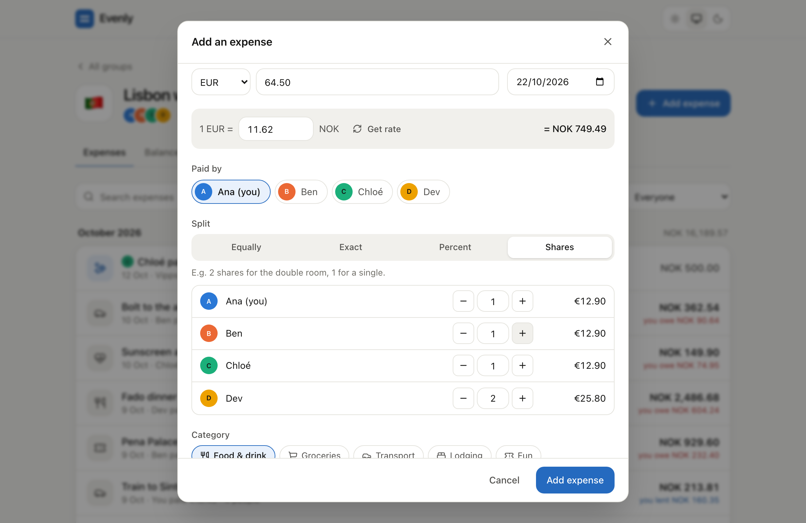
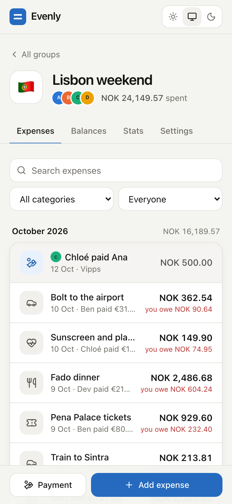
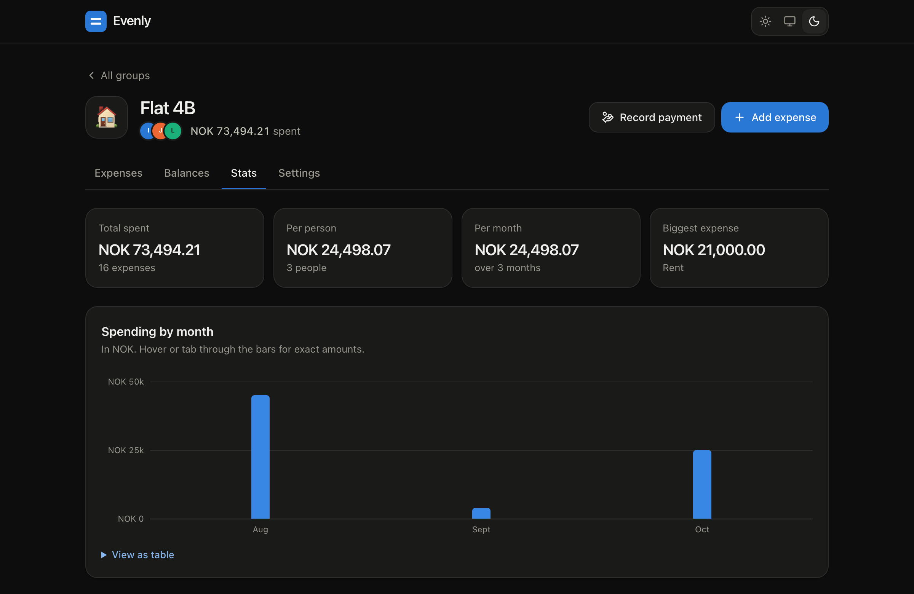

# Evenly

Split group expenses with friends, in any currency, and settle up in the
fewest possible payments. No account, no backend: your data stays in your
browser, and groups are shared as self-contained links.

[](https://github.com/mihaldzaferi/evenly/actions/workflows/ci.yml)

**Live demo:** https://mihaldzaferi.github.io/evenly/ (press *Try it with example data*)



## Features

- **Four ways to split.** Equally, by exact amounts, by percentage, or by
  shares ("2 shares for the double room, 1 for a single"), with a live
  preview of what each person owes.
- **Any currency.** Log each expense in the currency you paid in. Exchange
  rates for the expense date come from the European Central Bank (via the
  free [Frankfurter](https://frankfurter.dev) API), or you can type one in.
- **Fewest payments to settle up.** Evenly finds the smallest set of
  transfers that clears every balance, then you tick them off one by one.
- **Share by link.** The whole group is compressed into the link itself, so
  a friend can open it and add the group to their own device. No server sees it.
- **Stats.** Spending per day or month, by category, and who paid versus who
  consumed. Every chart also has a table view.
- **Works offline and installs like an app.** It has a service worker and a
  web app manifest, and it supports dark mode.
- **Import and export.** Download a group as CSV for Excel or Google Sheets, or
  back up everything as JSON and restore it later.
- **Undo instead of "are you sure?".** Deleting an expense, payment or group
  shows an undo button.

<p>
  
  
</p>



## How it works

### Money is exact

Amounts are stored as integers in the currency's smallest unit (cents, øre,
or whole yen), so there's no floating-point drift. Every split, in every
mode, goes through one function, `allocate()`. It hands out the leftover
units with the
[largest remainder method](https://en.wikipedia.org/wiki/Largest_remainder_method),
so the shares always add up to exactly the total. A €10 bill split three
ways is €3.34 + €3.33 + €3.33, never €9.99.

### Settling up in the fewest payments

If *n* people have a non-zero balance, *n − 1* payments are always enough.
You can often do better, though. When the group splits into *k* subgroups
whose balances each add up to zero, *n − k* payments are enough, and that is
the minimum. Plain "largest debtor pays largest creditor" matching misses
this:

| Balances | Greedy matching | Evenly |
| --- | --- | --- |
| +4, +3, +2, −5, −4 | 4 payments | 3 payments: (−4 → +4) and (−5 → +3, +2) |

Evenly finds the partition with the most zero-sum subgroups using dynamic
programming over subsets, which takes O(n·2ⁿ) time and is instant for up to
16 people with open balances. It then settles each subgroup with greedy
matching. Larger groups fall back to greedy alone. The test suite checks the
result against a brute-force search on hundreds of random groups
([`test/balances.test.ts`](test/balances.test.ts)).

### Share links without a server

A share link looks like `…/#/import?g=1.<data>`. The group is turned into
JSON, compressed with the browser's built-in `CompressionStream` (deflate),
and base64url-encoded. The example trip, with 14 expenses, fits in about
1,500 characters. Everything after the `#` stays in the browser and is never
sent to any server. On import, the data is checked field by field
([`src/lib/validate.ts`](src/lib/validate.ts)), so a hand-edited link can't
break your balances.

## Tech stack

- [React 19](https://react.dev) + [TypeScript](https://www.typescriptlang.org), built with [Vite](https://vite.dev)
- [Tailwind CSS 4](https://tailwindcss.com) with semantic colour tokens for light and dark mode
- [Zustand](https://zustand.docs.pmnd.rs) for state, saved to `localStorage`
- [React Router](https://reactrouter.com) (hash routing, so deep links work on GitHub Pages)
- [Vitest](https://vitest.dev) + [Testing Library](https://testing-library.com) for tests
- Native `<dialog>` for modals, which gives focus trapping and Esc to close for free

## Getting started

Requires Node 20.19 or newer.

```bash
npm install
npm run dev        # http://localhost:5173
```

```bash
npm test           # unit + component tests
npm run lint       # ESLint
npm run typecheck  # tsc
npm run build      # production build in dist/
```

### Keyboard shortcuts

| Key | Action |
| --- | --- |
| <kbd>N</kbd> | Add an expense |
| <kbd>P</kbd> | Record a payment |
| <kbd>/</kbd> | Search expenses |
| <kbd>Esc</kbd> | Close a dialog |

## Project structure

```
src/
  lib/          Pure logic, no React. Most of the tests live here.
    money.ts      Parsing, formatting, conversion, allocate()
    split.ts      Turning a split into per-person shares
    balances.ts   Per-member totals and the settle-up algorithm
    share.ts      Share-link encoding and decoding
    validate.ts   Checking imported data
    stats.ts      Totals by day, month and category
    csv.ts        CSV export
  store/        Zustand store (saved to localStorage) and toasts
  components/   Dialogs, charts, avatars and other shared UI
  pages/        Home, new group, import, and the group page's four tabs
test/           Vitest suites
```

## Deploying

Pushing to `main` runs two GitHub Actions workflows:

- **CI** runs lint, type checks, tests and the build.
- **Deploy to GitHub Pages** builds the app and publishes `dist/`. Turn it on
  once under *Settings → Pages → Source: GitHub Actions*.

The build uses relative asset paths and hash routing, so it also works from
any static host or sub-folder without changes.

## Privacy

Evenly has no backend. Groups live in your browser's `localStorage`. The
only network request the app makes is to fetch an exchange rate when you add
an expense in a foreign currency, and that request contains only the two
currency codes and a date.

## License

MIT
